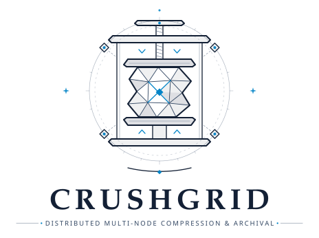
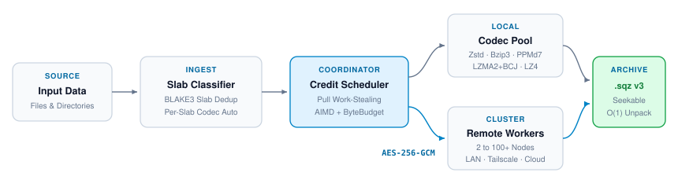

<p align="center">
  <picture>
    <source media="(prefers-color-scheme: dark)" srcset="assets/crushgrid-emblem-dark.svg" />
    <source media="(prefers-color-scheme: light)" srcset="assets/crushgrid-emblem-light.svg" />
    
  </picture>
</p>

<h1 align="center">CrushGrid</h1>

<p align="center">
  Distributed Multi-Node Compression &amp; Archival CLI in Rust
</p>

<p align="center">
  <a href="https://github.com/HUSMUS9999/crushgrid/releases"></a>
  <a href="docs/ALGORITHMS.md"></a>
  <a href="docs/ARCHITECTURE.md"></a>
  <a href="#install"></a>
  <a href="LICENSE"></a>
</p>

**CrushGrid** *(formerly `squiz-archive`, 100% `.sqz` archive & wire-protocol compatible)* distributes file and directory compression across multiple machines over LAN, Tailscale/WireGuard VPNs, or cloud networks. It compiles to a **single static Rust executable** bundling `libzstd`, `liblzma`, `libbzip3`, pure-Rust `PPMd7`, and `LZ4`, running identically as coordinator or worker on Linux, Windows, and macOS.

## Problem & Solution

**Problem:** High-ratio archival (`zstd -19`, `xz -6`) saturates a single machine for hours while spare workstations and servers on the same LAN or VPN sit idle. Standard archivers also force one global codec across mixed workloads — leaving ratio on the table across text, executables, and pre-compressed media — and produce monolithic streams that prevent parallel extraction and slab deduplication.

**Solution:** CrushGrid splits datasets into content-classified, `BLAKE3`-deduplicated slabs and distributes compression across `2` to `100+` Linux, Windows, and macOS nodes over `AES-256-GCM`-authenticated TCP using a pull-based work-stealing scheduler. Each slab is automatically routed to the best statically bundled codec (`Bzip3`, `LZMA2+BCJ`, `PPMd7`, `Zstd`, `LZ4`, or raw bypass) inside a seekable `.sqz` v3 archive that extracts in parallel.

## Features

- **Distributed Multi-Node Work-Stealing (`2` to `100+` Hosts)** — Pull-based credit-gated scheduler across heterogeneous Linux, Windows, and macOS nodes with automatic offline-node failover and adaptive wire pre-shrinking
- **6 Statically-Bundled Codecs + Per-Slab Auto-Routing** — Inspects each slab automatically: `Bzip3` (BWT+LZP+CM) for text/CSV/code, `LZMA2+BCJ` for x86 executables, `LZMA2`/`Zstd` for mixed data, and zero-copy raw bypass for already-compressed media
- **BLAKE3 Deduplication & `AES-256-GCM` Framing** — Content-addressed slab deduplication, authenticated encrypted cluster transport, bounded memory ceilings (`ByteBudget`), and `O(1)` parallel random-access extraction
- **Natural-Language CLI (`do` / `ask`) & Zero-Config Setup** — Express intent in natural language with `--dry-run` preview, run `crushgrid init` for 256-bit CSPRNG `0600` cluster config generation, and verify TCP/RAM/CPU tuning with `doctor` and `probe`
- **Single Portable Static Binary** — Zero runtime dependencies; identical executable serves as both coordinator (`pack`/`unpack`) and remote `worker`

---

## Quickstart

### 1. Local Compression & Extraction

```bash
# Compress with balanced defaults (creates ./backups.sqz)
crushgrid pack ./backups

# Higher ratio via per-slab automatic codec routing (Bzip3 + LZMA2-BCJ + raw bypass)
crushgrid pack ./backups --preset small

# Extract in parallel (creates ./backups)
crushgrid unpack backups.sqz

# Natural-language mode (prints the resolved CLI command; add --dry-run to preview)
crushgrid do "compress ./logs as small as possible using 50% cpu"
```

### 2. Multi-Node Cluster Setup (`2` to `100+` Hosts)

```bash
# Generate a 256-bit CSPRNG token and ~/.config/crushgrid/cluster.conf (0600 on Unix)
crushgrid init --nodes 192.168.1.40:7878,100.64.0.10:7878

# Start a worker on each contributing host (reads CRUSHGRID_TOKEN from env)
export CRUSHGRID_TOKEN="<token-from-init>"
crushgrid worker --bind 0.0.0.0:7878 --max-mem 8G

# Verify hardware, config, and OS TCP stack tuning
crushgrid doctor
crushgrid probe

# Compress across the cluster (auto-discovers cluster.conf; add -i / --pick to select nodes)
crushgrid pack ./dataset --preset small
```

Run `crushgrid -h` or `crushgrid <command> -h` for the full CLI reference.

---

## Presets

| Preset (`-m` / `--preset`) | Behavior | When to Use |
| :--- | :--- | :--- |
| **`fast`** | `Zstd L3` + BLAKE3 slab dedup | Scratch backups, high-speed links, peak local speed |
| **`balanced`** *(default)* | `Zstd L9 + LDM` + BLAKE3 slab dedup | Everyday compression speed and ratio |
| **`small`** | Per-slab auto: `Bzip3` (text/CSV), `LZMA2+BCJ` (x86 binaries), `LZMA2 L6` (mixed), raw bypass | High ratio without slow LZMA2-only wall times |
| **`max`** | Per-slab auto: `Bzip3 16M` (text/code), `LZMA2+BCJ L9` (binaries), `LZMA2 L9` (mixed) | Cold archival storage where smallest size matters |

Power users can override any preset with `--codec zstd|bzip3|ppmd|lzma2|lzma2-bcj|lz4|auto` and `--level N`.

---

## Architecture

<p align="center">
  <picture>
    <source media="(prefers-color-scheme: dark)" srcset="assets/crushgrid-arch-v2-dark.svg" />
    <source media="(prefers-color-scheme: light)" srcset="assets/crushgrid-arch-v2-light.svg" />
    
  </picture>
</p>

---

## Benchmarks

### 1. Unbiased Single-Host Comparison vs. Standard Tools (`14.71 MiB` Mixed Workload)

Measured live on the same Linux `x86_64` host over an identical `14.71 MiB` directory containing Rust source files, `95,000`-row CSV telemetry, and real `ELF64` binaries:

| Tool / Preset | Output Size | Ratio | Wall Time | Throughput | Honest Trade-Off |
| :--- | ---: | :-: | :-: | :-: | :--- |
| **`tar + gzip -6` (1T)** | `4.26 MiB` | `3.45×` | `0.355 s` | `41.5 MiB/s` | Ubiquitous everywhere; single-threaded, lowest ratio |
| **`tar + bzip2 -9` (1T)** | `2.98 MiB` | `4.93×` | `0.628 s` | `23.4 MiB/s` | Legacy BWT; single-threaded and slow |
| **`tar + zstd -T0 -3`** | `3.18 MiB` | `4.63×` | `0.041 s` | `361.9 MiB/s` | Standard fast local archiver; single-host only, no dedup or encryption |
| **`tar + zstd -T0 -19`** | `2.08 MiB` | `7.09×` | `2.210 s` | `6.7 MiB/s` | Tighter single-stream ratio on small inputs; `10×` slower than CrushGrid `max`, single-host only |
| **`tar + xz -T0 -6`** | **`1.90 MiB`** | **`7.73×`** | `2.575 s` | `5.7 MiB/s` | Highest single-stream ratio on small inputs; `11.9×` slower than CrushGrid `max`, single-host only |
| **`CrushGrid (--preset fast)`** | `3.42 MiB` | `4.30×` | **`0.030 s`** | **`487.9 MiB/s`** | **Fastest overall**; BLAKE3 dedup + `O(1)` parallel extract + scales across N nodes |
| **`CrushGrid (--preset balanced)`** | `3.18 MiB` | `4.63×` | `0.056 s` | `264.5 MiB/s` | Matches `zstd -3` size with slab dedup + cluster distribution |
| **`CrushGrid (--preset small)`** | `2.53 MiB` | `5.81×` | `0.253 s` | `58.0 MiB/s` | Automatic per-slab Bzip3 + LZMA2-BCJ routing (`10×` faster than `xz -6`) |
| **`CrushGrid (--preset max)`** | `2.43 MiB` | `6.05×` | `0.216 s` | `68.1 MiB/s` | Independent slabs trade a small solid-stream ratio gap vs `xz` for `11.9×` speed, dedup & N-node scaling |

### 2. Single-Core Codec Comparison (`8 MiB` Real Workloads)

| Codec | CSV Telemetry (`8 MiB`) | ELF Binaries (`8 MiB`) | C Headers (`4 MiB`) |
| :--- | :--- | :--- | :--- |
| `zstd L9` | `4.20×` (`68.3 MiB/s`) | `2.54×` (`71.2 MiB/s`) | `7.28×` (`109.1 MiB/s`) |
| `zstd L19` | `4.91×` (`2.1 MiB/s`) | `2.79×` (`4.6 MiB/s`) | `8.16×` (`5.2 MiB/s`) |
| `bzip3` (BWT+LZP+CM) | `4.70×` (`15.5 MiB/s`) | `2.79×` (`13.1 MiB/s`) | **`8.81×`** (`20.5 MiB/s`) |
| `ppmd` (PPMd7 order 8) | `4.55×` (`9.8 MiB/s`) | `2.79×` (`7.4 MiB/s`) | `8.70×` (`28.6 MiB/s`) |
| `lzma2 L6` | `4.89×` (`2.5 MiB/s`) | `2.96×` (`3.6 MiB/s`) | `8.39×` (`5.1 MiB/s`) |
| `lzma2-bcj L6` (x86) | `4.89×` (`2.7 MiB/s`) | **`3.13×`** (`3.5 MiB/s`) | `8.39×` (`4.8 MiB/s`) |

### 3. 3-Node Cluster Testbed (Shared 5 GHz Wireless LAN, `AES-256-GCM` Enabled)

- **Coordinator:** Windows `x86_64`, 6C/12T (2.6 GHz), 16 GiB RAM (10T compute, 2T I/O)
- **Worker 1:** Linux `x86_64`, 16C/32T (2.5–5.4 GHz), 30 GiB RAM
- **Worker 2:** Linux `x86_64`, 12C/20T (2.1–4.9 GHz), 62 GiB RAM

| Workload | Preset / Codec | Local (`12T`) | Cluster (`62T`) | Speedup | Ratio |
| :--- | :--- | :--- | :--- | ---: | ---: |
| `256 MiB` CSV dataset | `zstd L19` (`8M` blk) | `8.3 MiB/s` | `23.3 MiB/s` | **`2.81×`** | `4.94×` |
| `256 MiB` CSV dataset | `lzma2 L6` (`8M` blk) | `10.9 MiB/s` | `28.8 MiB/s` | **`2.65×`** | `4.92×` |
| `256 MiB` mixed-entropy | `zstd L19` (`2M` blk) | `12.0 MiB/s` | `35.1 MiB/s` | **`2.91×`** | `3.69×` |
| `128 MiB` PE binaries | `lzma2 L6` (`2M` blk) | `22.9 MiB/s` | `39.6 MiB/s` | **`1.73×`** | `3.38×` |
| `1.25 GiB` directory (`23k` files) | `zstd L12` (`.sqz`) | — | `90.6 s` (`312 MiB` out) | — | `4.11×` |
| `185.5 GiB` CSV dataset (`107` files) | `zstd L9` (`.sqz`, `8M`) | — | `2748 s` (`45.2 GiB` out, `69.1 MiB/s`) | — | `4.10×` |
| `256 MiB` parallel decompress | `zstd` (`auto`) | `0.10 s` (`2566 MiB/s`) | `0.12 s` (`2108 MiB/s`) | `0.83×`* | — |

*\*In `auto` mode, fast Zstd decompression stays local because local decode throughput exceeds wireless RX bandwidth; the `20 ms` delta is cluster setup overhead.*

---

## Install

Download prebuilt binaries from [Releases](https://github.com/HUSMUS9999/crushgrid/releases), or build from source (Rust 1.85+):

```bash
git clone https://github.com/HUSMUS9999/crushgrid.git
cd crushgrid

# Native CPU tuning (AVX2 / AVX-512 / AES-NI)
RUSTFLAGS="-C target-cpu=native" cargo build --release

# Cross-compile Windows .exe from Linux (requires mingw-w64)
rustup target add x86_64-pc-windows-gnu
RUSTFLAGS="-C target-cpu=x86-64-v3 -C target-feature=+aes,+pclmulqdq" cargo build --release --target x86_64-pc-windows-gnu

# Run Rust test suite
cargo test
```

---

## Documentation

- **[Codec Selection & Auto-Routing](docs/ALGORITHMS.md)** — All 6 codecs, per-slab classifier, and empirical trade-offs.
- **[Architecture & Security Model](docs/ARCHITECTURE.md)** — Pipeline design, `.sqz` v3 binary format, and `AES-256-GCM` framing.
- **[Cluster Deployment Guide](docs/CLUSTER_SETUP.md)** — LAN, Tailscale/WireGuard, cloud deployment (`systemd`, Windows Task), and OS TCP tuning scripts (`scripts/`).
- **[CLI Reference](docs/CLI_REFERENCE.md)** — Complete command, preset, natural-language, and flag reference.
- **[Changelog](CHANGELOG.md)** — Release history.

---

## License

MIT License — see [LICENSE](LICENSE).
